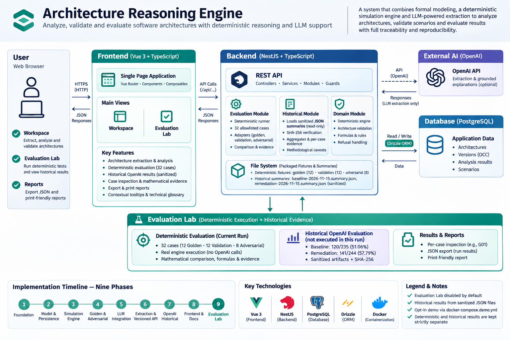
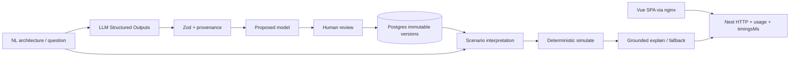

# Architecture Reasoning Engine

Deterministic “what happens if” analysis for software architectures. Natural language **extracts** a formal model and **explains** engine results. **All architecture numbers come from hand-verifiable TypeScript**, not from the LLM.

**Status:** Phases 1–9 complete for submission readiness (including Evaluation Lab). Keep the repository **private until the defense session** (REQ-172).

Central principle: **LLMs interpret and explain. Deterministic code performs numerical reasoning.**

## Project overview

1. Extract a typed architecture document from prose (**proposed only** — never auto-persisted).
2. Validate with Zod + semantic findings; review/correct JSON explicitly.
3. Persist **immutable versions** in PostgreSQL (optimistic concurrency).
4. Interpret a question into one of three supported scenarios (or refuse).
5. Run pure `simulate(architecture, scenario)` for capacity, load, utilization, timeouts, failure exposure — or explicit refusals.
6. Produce a grounded explanation (or deterministic fallback).
7. Expose token usage, estimated USD (when priced), and stage timings.

The engine does **not** invent availability %, successful throughput, or p95/p99 latency.

## System Architecture



The Vue 3 SPA talks to a NestJS API that keeps LLM roles (optional OpenAI Structured Outputs, or Fake for offline demos) separate from a pure deterministic simulation engine. Validated models are versioned in PostgreSQL via Drizzle ORM. The opt-in Evaluation Lab re-runs allowlisted golden, validation, and adversarial fixtures and surfaces historical OpenAI evidence without mixing those metrics into deterministic run totals.

## Architecture



## Stack

| Layer | Technology |
| --- | --- |
| API | NestJS, TypeScript (strict) |
| Validation | Zod |
| Persistence | PostgreSQL 16, Drizzle |
| Simulation | Pure TS (`src/simulation`) — no Nest/DB/LLM imports |
| LLM | OpenAI Responses + Structured Outputs; **Fake** for local/CI |
| Frontend | Vue 3 + Vite + Tailwind; nginx in Compose |
| Tests | Vitest |

## Quick start (Docker Compose)

```bash
cp .env.example .env   # LLM_PROVIDER=fake by default
docker compose up -d --build
```

| Service | URL |
| --- | --- |
| Browser SPA | **http://127.0.0.1:8080** (`WEB_PORT`) |
| Evaluation Lab (UI) | **http://127.0.0.1:8080/evaluation** (API gated — see below) |
| API (direct) | http://127.0.0.1:3000 |
| Health | http://127.0.0.1:8080/health or :3000/health |

nginx serves the SPA and proxies `/api/*` → Nest (prefix stripped). Same-origin; no broad CORS.

### Evaluation Lab (opt-in)

HTTP evaluation endpoints are **disabled by default** (`EVAL_LAB_ENABLED` unset/`0` → 403). The SPA may still show the nav link; the **backend** enforces the gate.

Enable for local defense demos (also forces Fake LLM):

```bash
docker compose -f docker-compose.yml -f docker-compose.demo.yml up -d --build
```

Then open http://127.0.0.1:8080/evaluation → **Run evaluation suite** (default `deterministic_full`, 32 cases). Historical OpenAI metrics appear in a separate panel and are **not** part of the run totals.

Acceptance:

```bash
npx tsx scripts/compose-frontend-acceptance.ts
npx tsx scripts/compose-http-acceptance.ts
npx tsx scripts/compose-evaluation-acceptance.ts   # requires demo override
```

Defense demo script: [`docs/defense/DEMO.md`](docs/defense/DEMO.md).

### Local API + Vite (optional)

```bash
docker compose up -d postgres
cp .env.example .env && npm ci && npm run db:migrate && npm run start:dev
cd frontend && npm ci && npm run dev   # http://127.0.0.1:5173
```

## Environment

| Variable | Role |
| --- | --- |
| `PORT` | API port (default `3000`) |
| `WEB_PORT` | nginx SPA port (default `8080`) |
| `DATABASE_URL` | Postgres (Compose API uses host `postgres`) |
| `POSTGRES_*` | Compose DB credentials |
| `LLM_PROVIDER` | `fake` (default) or `openai` |
| `OPENAI_API_KEY` | Required only for `openai` (API container / host — **never** in frontend image) |
| `OPENAI_MODEL` | Default `gpt-4.1` |
| `OPENAI_TIMEOUT_MS` | Default `60000`; provider retries **0** |
| `RUN_LIVE_OPENAI` | Must be `1` for live eval scripts — never in CI |
| `EVAL_LAB_ENABLED` | Must be `1` for `/evaluation/*` API — default off; demo override sets it |

## Fake vs OpenAI

| | Fake | OpenAI |
| --- | --- | --- |
| Cost / network | Zero; offline | Paid; opt-in |
| Purpose | Demo, CI, Compose acceptance | Measured extraction quality |
| Accuracy claim | **None** for unseen prose | Measured on fixed V01–V12 only |

## Workflow

1. **Extract** `POST /architectures/extract` → `PROPOSED` document (not persisted).
2. **Validate** `POST /architectures/validate`; edit JSON as needed.
3. **Persist** `POST /architectures` → version 1; later `PUT` with `expectedVersion` → new version (HTTP **409** on stale OCC).
4. **Analyze** `POST /architectures/:id/versions/:version/analyze` with a question.
5. **Diff** `GET /architectures/:id/diff?from=&to=`.
6. Inspect **usage** / **timingsMs** on responses (Fake cost often `null`).

Supported scenarios: load×N, latency degradation, component unavailable. Unsupported questions (e.g. availability %) return explicit `UNSUPPORTED` / refusals — never a plausible invented %.

## Testing

```bash
# Backend
npm run typecheck && npm run lint && npm test && npm run test:integration && npm run build

# Frontend
cd frontend && npm run typecheck && npm run lint && npm test && npm run build
```

Goldens G01–G12, validation V01–V12, adversarial ADV-01–08 — see [`VALIDATION.md`](VALIDATION.md).

## Evaluation Lab vs Vitest vs historical OpenAI

| Kind | What it is | How to run |
| --- | --- | --- |
| Vitest regression | CI unit/golden/adversarial/validation specs | `npm test` |
| Evaluation Lab (deterministic) | Allowlisted domain adapters via HTTP; expected vs actual + formulas | Compose demo override + `/evaluation` |
| Historical OpenAI evidence | Sanitized Phase 7 artifacts (no re-run) | `GET /evaluation/historical` when Lab enabled |

Raw live dumps stay gitignored under `artifacts/`. Git-tracked summaries: `src/evaluation/historical/*.summary.json` (generated by `npm run eval:sanitize-historical` from local artifacts; never invent numbers).

## Evaluation results (measured; caveats apply)

Latest remediation regression on **same** V01–V12 dataset (not a held-out generalization bench):

| Metric | Value |
| --- | --- |
| Field accuracy | **141/244 (57.8%)** — denom. shifted vs baseline 120/235 |
| Node / Dep F1 | **0.86 / 0.84** |
| Supported scenarios | **10/10** (formal context) |
| Unsupported | **2/2** |
| Grounded explanations | **9/10** |

Baseline first pass preserved in VALIDATION.md. Scenario scoring used **formal** architecture context — full extract→scenario not measured. Small-N latency ≠ production SLO.

## Mandatory documentation

| Doc | Path |
| --- | --- |
| Decisions | [`DECISIONS.md`](DECISIONS.md) |
| Formal model & math | [`MODEL.md`](MODEL.md) |
| Validation evidence | [`VALIDATION.md`](VALIDATION.md) |
| Omissions | [`NOT_DONE.md`](NOT_DONE.md) |
| Requirements | [`docs/specification/TECHNICAL_REQUIREMENTS.md`](docs/specification/TECHNICAL_REQUIREMENTS.md) |
| Coverage matrix | [`docs/engineering/REQUIREMENTS_COVERAGE.md`](docs/engineering/REQUIREMENTS_COVERAGE.md) |
| Decision log | [`docs/engineering/DECISION_LOG.md`](docs/engineering/DECISION_LOG.md) |
| Phases | [`docs/engineering/PHASES.md`](docs/engineering/PHASES.md) |
| Defense presentation | [`docs/defense/PRESENTATION.md`](docs/defense/PRESENTATION.md) |
| Live demo | [`docs/defense/DEMO.md`](docs/defense/DEMO.md) |
| Q&A | [`docs/defense/QA.md`](docs/defense/QA.md) |
| Live-change prep | [`docs/defense/LIVE_CHANGES.md`](docs/defense/LIVE_CHANGES.md) |

## API sketch

| Method | Path | Notes |
| --- | --- | --- |
| `GET` | `/health` | Liveness |
| `POST` | `/architectures/extract` | Never persists |
| `POST` | `/architectures/validate` | Findings + canPersist |
| `POST` | `/architectures` | Create v1 |
| `PUT` | `/architectures/:id` | OCC `expectedVersion` |
| `GET` | `/architectures/:id` / `.../versions` / `.../versions/:v` | Inspect |
| `GET` | `/architectures/:id/diff?from=&to=` | Semantic diff |
| `POST` | `/architectures/:id/versions/:v/analyze` | Scenario + simulate + explain |
| `GET` | `/evaluation/suites` | Lab catalog (403 unless `EVAL_LAB_ENABLED=1`) |
| `POST` | `/evaluation/runs` | Deterministic suite run |
| `GET` | `/evaluation/historical` | Sanitized OpenAI summaries (not live) |

Browser clients call the same paths under `/api/...` via nginx or Vite.
