# Architecture Reasoning Engine

Deterministic “what happens if” analysis for software architectures. Natural language is used to **extract** a formal model and to **explain** engine results. **All numerical answers come from hand-verifiable TypeScript**, not from the LLM.

**Status:** Phases 1–7 complete (formal model, persistence, simulation, LLM seams, HTTP orchestration, validation/benchmarking). Phase 8 (defense packaging) is not started.

Central principle: **LLMs interpret and explain. Deterministic code performs numerical reasoning.**

## Project overview

The system:

1. Extracts a typed architecture document from natural-language descriptions (proposed only — **not** auto-persisted).
2. Validates structure, provenance of declared quantities, and semantic warnings via Zod + domain checks.
3. Persists immutable, versioned architectures in PostgreSQL (optimistic concurrency).
4. Interprets a natural-language question into one of three supported scenarios.
5. Runs a pure `simulate(architecture, scenario)` engine that computes capacity, load, utilization, timeout violations, and failure exposure — or refuses with explicit reason codes.
6. Produces a grounded explanation (LLM qualitative text + deterministic evidence), or a deterministic fallback when validation fails.
7. Returns request-scoped token usage, estimated USD, and stage timings.

Assumptions, unknowns, conflicts, and refusals are first-class. The engine does **not** invent availability %, successful throughput, or end-to-end p95/p99 latency.

## System architecture

```mermaid
flowchart LR
  NL[Natural-language architecture / question]
  EXT[LLM extraction Structured Outputs]
  ZOD[Zod + provenance validation]
  PROP[Proposed architecture not persisted]
  HUM[Human review / correction]
  PERS[Immutable persisted version PostgreSQL]
  SCEN[LLM scenario interpretation]
  SIM[Deterministic simulate]
  EXP[Grounded explanation or deterministic fallback]
  API[HTTP response + usage + timingsMs]

  NL --> EXT --> ZOD --> PROP --> HUM --> PERS
  PERS --> SCEN --> SIM --> EXP --> API
  NL --> SCEN
```



Extraction (`POST /architectures/extract`) never writes to the database. Persistence is always an explicit `POST /architectures` (or later `PUT` with OCC). Analysis always targets an **exact** `architectureId` + `version`.

## Technology stack

| Layer | Technology |
| --- | --- |
| API | NestJS (Express), TypeScript (strict) |
| Validation | Zod |
| Persistence | PostgreSQL 16, Drizzle ORM |
| Simulation | Pure TypeScript (`src/simulation`) — no Nest/Drizzle/HTTP/LLM imports |
| LLM | OpenAI Responses API + Structured Outputs; **Fake** provider for local/CI |
| Tests | Vitest |
| Runtime | Docker Compose (`postgres` + `api`) |

Optional OpenTelemetry collectors and Ollama services are **not** part of the default Compose stack.

## Quick start

### Prerequisites

- Node.js 20+ (22 recommended)
- Docker and Docker Compose
- `npm ci` for local development

### Environment

```bash
cp .env.example .env
```

Defaults use `LLM_PROVIDER=fake` (no OpenAI network calls). Compose injects `DATABASE_URL` for the `api` service automatically.

### Docker Compose

Migrations run on API startup (`src/main.ts`).

```bash
docker compose up --build
```

Health check:

```bash
curl http://localhost:3000/health
```

Optional HTTP acceptance against Fake LLM (no API key required):

```bash
npx tsx scripts/compose-http-acceptance.ts http://127.0.0.1:3000
```

Shutdown:

```bash
docker compose down
```

### Local development (API on host)

```bash
cp .env.example .env
npm ci
docker compose up postgres -d
npm run db:migrate
npm run start:dev
```

Verification (Fake LLM; no live OpenAI):

```bash
npm run typecheck
npm run lint
npm test
npm run test:integration   # requires DATABASE_URL
npm run build
```

## Configuration

From [`.env.example`](.env.example):

| Variable | Role |
| --- | --- |
| `PORT` | HTTP port (default `3000`) |
| `DATABASE_URL` | Postgres connection (host uses `localhost`; Compose API uses hostname `postgres`) |
| `POSTGRES_*` | Compose Postgres credentials / DB name / host port |
| `LLM_PROVIDER` | `fake` (default) or `openai` |
| `OPENAI_API_KEY` | Required only when `LLM_PROVIDER=openai` |
| `OPENAI_MODEL` | Default `gpt-4.1` |
| `OPENAI_TIMEOUT_MS` | Default `60000`; provider retries are hardcoded to `0` |
| `LLM_MAX_ARCHITECTURE_CHARS` / `LLM_MAX_QUESTION_CHARS` | Optional input limits |
| `RUN_LIVE_OPENAI` | Must be `1` to opt into live evaluation scripts — **never** set in CI |

**Fake mode** is for local development, Compose demos, and default tests. **OpenAI mode** requires a real key and incurs estimated API charges. Live evaluation (`npm run llm:live-eval` / `scripts/live-validation-eval.ts`) is gated, capped at 34 provider calls, and must not run automatically.

Do not commit real credentials.

## API reference

Base URL examples assume `http://localhost:3000`.

### `GET /health`

Liveness. Response includes `status`, `service`, `version`, `timestamp`.

### `POST /architectures/extract`

Propose a formal model from natural language. **Does not persist.**

```bash
curl -s -X POST http://localhost:3000/architectures/extract \
  -H "Content-Type: application/json" \
  -d "{\"architectureText\":\"The API service runs 4 replicas, each handling 80 requests per second. Capacity is the sum across replicas. Baseline ingress traffic is 80 rps into the API.\"}"
```

Body (strict): `{ "architectureText": string }`.

Success (`200`): `status` (`PROPOSED` | `EXTRACTION_FAILED`), `document`, `findings`, `gaps`, `clarificationQuestions`, `notes`, `canPersist`, `usage`, `errorClass`, optional `message`.

### `POST /architectures/validate`

Validate a document without persisting.

```bash
curl -s -X POST http://localhost:3000/architectures/validate \
  -H "Content-Type: application/json" \
  --data-binary @tests/fixtures/architectures/checkout-pricing.json
```

Body: `{ "document": <ArchitectureDocument> }`.

### `POST /architectures`

Create immutable version 1.

```bash
curl -s -X POST http://localhost:3000/architectures \
  -H "Content-Type: application/json" \
  --data-binary @tests/fixtures/architectures/checkout-pricing.json
```

Body: `{ "document": <ArchitectureDocument>, "changeSource"?: "manual" | "user_corrected" | "approved_extraction" }`.  
`changeSource` is client-declared metadata only (not proof of human approval). Default: `manual`.

Response envelope: `architectureId`, `version`, `schemaVersion`, `document`, `findings`, `changeSource`, `createdAt`.

### `GET /architectures/:id`

Latest version envelope.

### `GET /architectures/:id/versions`

`{ architectureId, versions: [...] }`.

### `GET /architectures/:id/versions/:version`

Exact immutable version envelope.

### `PUT /architectures/:id`

Optimistic concurrency update. Body:

```json
{
  "expectedVersion": 1,
  "document": {},
  "changeSource": "user_corrected"
}
```

Conflict → HTTP `409`.

### `GET /architectures/:id/diff?from=&to=`

Deterministic semantic diff between two versions (`from` and `to` are integers).

### `POST /architectures/:id/versions/:version/analyze`

Scenario extraction → simulation → explanation for an **exact** stored version.

```bash
curl -s -X POST "http://localhost:3000/architectures/<id>/versions/1/analyze" \
  -H "Content-Type: application/json" \
  -d "{\"question\":\"At the current baseline load (1x), what is the API utilization?\"}"
```

Body (strict): `{ "question": string }`.

Response (`200` for domain outcomes including unsupported/clarification/not-answerable): `architectureId`, `architectureVersion`, `scenarioExtraction`, `simulation`, `explanation`, `usage`, `timingsMs`.

Provider infrastructure failures map to HTTP `503`; oversized input to `400`; missing architecture/version to `404`.

## End-to-end workflow

1. **Extract** (Fake LLM in Compose): `POST /architectures/extract` with `architectureText`. Inspect `document`, `findings`, `gaps`, `canPersist`.
2. **Correct** locally if needed (IDs, quantities, conflicts). Optionally `POST /architectures/validate`.
3. **Persist**: `POST /architectures` with `{ "document": ..., "changeSource": "approved_extraction" }`. Note `architectureId` and `version`.
4. **Analyze** that version: `POST /architectures/:id/versions/:version/analyze` with a question.
5. **Inspect** `scenarioExtraction`, `simulation.metrics` / `simulation.refused`, `explanation.source`, and `usage` / `timingsMs`.

A ready-made path is `scripts/compose-http-acceptance.ts` against a running Compose API with `LLM_PROVIDER=fake`.

## Supported scenarios

| Type | Meaning | Typical calculations |
| --- | --- | --- |
| `component_unavailable` | Named component fails | Failure exposure labels; not a probabilistic outage proof |
| `latency_degradation` | Named component latency (ms) | Timeout violation on sync inbound edges; always refuses E2E latency aggregation |
| `load_multiplication` | Traffic × multiplier `N` (including baseline `1`) | Offered load, capacity, utilization, saturation; optional attempt-rate upper bounds under strict assumptions |

Standing refusals (always present): availability %, successful throughput, latency distributions (p95/p99). Additional refusals apply when data is incomplete (missing baseline traffic, incomplete inbound fan-out, sync cycles, unspecified aggregation, etc.). See [docs/engineering/MODEL.md](docs/engineering/MODEL.md).

Unsupported NL questions (availability %, reliability nines, uptime probability, E2E p95/p99) should classify as `UNSUPPORTED` rather than inventing a structured scenario.

## Validation and measured results

Offline (default `npm test` / integration — **Fake LLM only**):

- 12 golden simulation cases (G01–G12)
- 12 architecture/question validation pairs (V01–V12)
- Adversarial suite
- **157** unit/golden/adversarial/validation tests
- **12** integration tests (repository + HTTP)

Live OpenAI (opt-in, human-approved, gitignored artifacts under `artifacts/eval/`):

| | Baseline (frozen) | Remediation regression (same dataset) |
| --- | ---: | ---: |
| Arch field matches/total | 120/235 (51.1%) | 141/244 (57.8%) |
| Node F1 | 0.83 | 0.86 |
| Dependency F1 | 0.74 | 0.84 |
| Supported scenarios | 10/10 | 10/10 |
| Unsupported classification | 1/2 | 2/2 |
| Grounded explanations | 9/10 | 9/10 |
| Est. USD (2nd run) | — | **~$0.203** (pricing table ≠ invoice) |

Important caveats:

- The **field-accuracy denominator changed** between runs (conflict scoring rows + more matched nodes). Field % is directional; prefer P/R/F1 and scenario metrics for comparison.
- The second pass is a **same-dataset remediation regression**, not an independent generalization benchmark.
- Scenario scoring used the **hand formal model** as context — not full extract→scenario end-to-end.
- Real extraction completeness remains limited (residual omitted quantities and ID slug drift).

Full methodology and evidence: [VALIDATION.md](VALIDATION.md).

## Observability

Per HTTP analysis/extract request:

- Token usage and **estimated** USD (`usage`; pricing table, not billing)
- Provider operation durations and end-to-end `timingsMs`
- Explanation `source` (`llm+deterministic` vs `deterministic_fallback`) with optional `validationErrors` / `validationErrorCodes`

Evaluation artifacts (gitignored) record sanitized diagnostics for live runs. **Request timings are not modeled architecture latency** (the engine refuses p95/p99 architecture claims).

## Known limitations

- Residual architecture extraction omissions (`missing_in_dto` still dominates live quantity misses).
- Generated component IDs can diverge from fixture slugs (`api` vs `api-service`).
- Evaluation dataset is small (V01–V12); live p95 with N=12 is weak.
- No probabilistic reliability / availability / E2E percentile model.
- Extracted architectures are **never** auto-persisted.
- The system does not make autonomous architectural decisions; it analyzes stated models under narrow scenarios.
- No auth, multitenancy, UI, RAG, or external OTel collector in this repo.

There is no root `NOT_DONE.md` or `DECISIONS.md`; use [docs/engineering/PHASES.md](docs/engineering/PHASES.md) limitations and [docs/engineering/DECISION_LOG.md](docs/engineering/DECISION_LOG.md).

## Documentation

| Document | Purpose |
| --- | --- |
| [AGENTS.md](AGENTS.md) | Agent/process invariants |
| [docs/specification/TECHNICAL_REQUIREMENTS.md](docs/specification/TECHNICAL_REQUIREMENTS.md) | Case requirements |
| [docs/engineering/MODEL.md](docs/engineering/MODEL.md) | Simulation mathematics |
| [docs/engineering/PHASES.md](docs/engineering/PHASES.md) | Phase status and verification evidence |
| [docs/engineering/DECISION_LOG.md](docs/engineering/DECISION_LOG.md) | Engineering decisions |
| [docs/engineering/LEARNINGS.md](docs/engineering/LEARNINGS.md) | Reusable lessons |
| [VALIDATION.md](VALIDATION.md) | Goldens, live eval methodology and measured results |

## Privacy

Keep this repository private until the hiring defense session (REQ-172).
